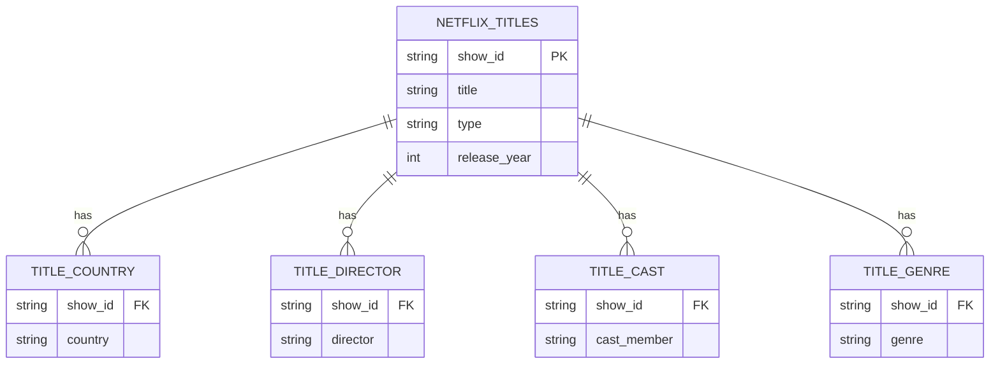

# Netflix Catalog Analysis (SQL)

## Overview

**Is our shrinking attention span reshaping Netflix's content strategy?** This project uses SQL to analyze the composition of Netflix's content catalog: who produces it, how it splits between Movies and TV Shows, and how that mix has changed over time. The analysis is framed around a broader hypothesis: as audience attention spans shrink, *streaming platforms may be adapting their catalogs toward shorter, more fragmented content*.

**Key finding** The catalog is geographically concentrated (the United States and India are the only countries above a 10% share of titles) and leans toward Movies, with Japan and South Korea as TV-heavy exceptions. Over time, the Movie share of yearly additions dipped slightly after 2018, but the shift is driven by fewer Movies being added rather than more TV Shows: evidence for an attention-driven change in catalog strategy is weak.

 

## Database and Assumptions

The dataset is sourced from [Kaggle – Netflix Movies and TV Shows](https://www.kaggle.com/datasets/shivamb/netflix-shows)
and represents a static snapshot, not real-time data.

- **Catalog, not consumption**: the data describes Netflix's *offering*, not
  actual viewership. The analysis assumes that catalog composition may
  reflect shifts in consumer behavior, without claiming a causal relationship.
- **Duration trend limited to Movies**: when comparing content duration over
  time, only Movies are included. TV Shows are excluded from this specific
  analysis for two reasons: season count is not an objective proxy for
  duration (episode count and length vary widely across shows), and the
  dataset provides no indication of whether a show is completed or still
  ongoing (making season count unreliable even setting the first issue aside).

## Database Inspection and Schema Redesign

The original dataset consists of **8,807 titles**, with `date_added`
(the date a title entered the catalog) ranging from **2014 to 2021** —
distinct from `release_year`, referred to the content production date.
`duration` is recorded in minutes for Movies and in seasons for TV Shows,
requiring separate handling of the two content types throughout the analysis.

The main structural issue, however, is that several variables — `director`,
`cast`, `country` and `listed_in` — store **multiple items within a single
cell**. This prevents reliable use of aggregate functions (e.g. `COUNT`) and
called for a re-modeling of the database.

The adopted solution uses Python to **split each of these variables into a
dedicated supporting table**, duplicating rows by `show_id` for every
additional item found. Each supporting table is keyed back to the original
database via `show_id`: this keeps the core dataset lean and computation-friendly,
while `show_id` (efficient for joins but uninformative on its own) is
paired in the supporting tables with attributes like `title`, needed to make
results interpretable. An example of the new relational scheme is given here:

## Key Challenges

- **Different units for `duration` field** for Movies and TV Shows impose the structuring of a different analysis for the two subgroups.
- **Missing values in `country`** accounting for ~9.5% of the titles and handling as a separate category
- **Multi-value attributes** stored in single cells and the consequent need for normalization

## Analysis

### Content production across countries

*Note: titles with a **missing `country` value** were checked individually to detect potential patterns (e.g. by genre) before deciding how to treat them. No meaningful pattern emerged — the missing values appear heterogeneous — so these titles were retained in the total count when computing Movies/TV Shows percentages by country and **included in the `country` value Unknown**.*

It is worth noting that the choice of reporting extensively only the top 10 countries by total title production - for the part of the analysis that comes further, too - stems from the fact that their volume allows to interpret more consistently their Movies and TV Shows production and consequently the percentage of Movies metric. Complementarily, the log-scale scatterplot including all countries is offered to provide a more global point of view, even if as production volume decreases the values are more unreliable.

Ranking countries by number of titles produced reveals a strongly concentrated catalog: the **United States** and **India** are the only countries to exceed the threshold of **10% share** of total titles, while all other producers trail well behind.

  

| country        | num_titles | contribution_pct |
|----------------|--------|---------|
| United States  | 3690   | 41.90   |
| India          | 1046   | 11.88   |
| Unknown        | 838    | 9.52    |
| United Kingdom | 806    | 9.15    |
| Canada         | 445    | 5.05    |
| France         | 393    | 4.46    |
| Japan          | 318    | 3.61    |
| Spain          | 232    | 2.63    |
| South Korea    | 231    | 2.62    |
| Germany        | 226    | 2.57    |

<em>Top 10 countries by percentage contribution to catalog production</em>

Beyond volume, the balance between Movies and TV Shows varies significantly across these countries. Comparing each country's Movie output against its TV Show output highlights a distinct group of **TV-heavy producers**: Japan, South Korea stand out with a markedly low share of movies relative to TV shows — consistent with strong domestic TV/drama and anime industries — alongside a handful of countries showing the same pattern on a much smaller production volume and therefore less statistically meaningful.

Conversely, the United States, India and other countries not present in the top 10 by total titles produced (e.g. Hong Kong, Indonesia, Philippines and United Arab Emirates) prove to be more **Movie-heavy producers**.

  

<table>
<tr>
<th>country</th>
<th>movies</th>
<th>tv_shows</th>
<th>total_titles</th>
<th>pct_movies</th>
</tr>
<tr><td>United States</td><td>2752</td><td>938</td><td>3690</td><td>74.58</td></tr>
<tr><td>India</td><td>962</td><td>84</td><td>1046</td><td>91.97</td></tr>
<tr><td>Unknown</td><td>446</td><td>392</td><td>838</td><td>53.22</td></tr>
<tr><td>United Kingdom</td><td>534</td><td>272</td><td>806</td><td>66.25</td></tr>
<tr><td>Canada</td><td>319</td><td>126</td><td>445</td><td>71.69</td></tr>
<tr><td>France</td><td>303</td><td>90</td><td>393</td><td>77.10</td></tr>
<tr><td>Japan</td><td>119</td><td>199</td><td>318</td><td>37.42</td></tr>
<tr><td>Spain</td><td>171</td><td>61</td><td>232</td><td>73.71</td></tr>
<tr><td>South Korea</td><td>61</td><td>170</td><td>231</td><td>26.41</td></tr>
<tr><td>Germany</td><td>182</td><td>44</td><td>226</td><td>80.53</td></tr>
</table>

<em>Movies vs TV Shows production by country (Top 10 by total titles)</em>

An interesting point emerging from this breakdown is that the Movies/TV Shows mix plausibly reflects the **structure of local industries** (e.g. anime and drama production in Japan and South Korea) rather than viewers' preferences alone. This matters for the analysis that follows: a shift in the geographic composition of the catalog could alter the aggregate mix over time even with no change in attention-related behavior (a **composition effect**). Since the temporal analysis is run on the aggregate catalog, this effect is not controlled for and is acknowledged as a limitation (see *Limitations & Next Steps*).

### Evolution of short vs. long contents

The temporal analysis uses the year a title was added to the catalog (`date_added`) and, as anticipated in *Dataset & Assumptions*, is carried out at two levels. First, yearly additions are broken down by type (Movies and TV Shows), in absolute and relative terms. Then, since duration is not comparable across the two types, average duration is analyzed on Movies only.

On one hand, the new additions to the catalog (total and distinguished by content type) are paired with the metric of `pct_movies` consistently with the previous section.

- **Volume of additions**: yearly additions grow steadily until 2019 (about 2,000 titles) and decline in 2020 (about 1,900).
- **Content mix**: the Movie share peaks at 75% in 2018, then slips to 71% in 2019, 68% in 2020 and 66% in 2021, a mild shift toward TV Shows (from about 25% to 34% of additions). Over the full 2016-2021 window the series is not monotonic, so this is consistent with the hypothesis but not conclusive. The shift is driven by fewer Movies being added rather than more TV Shows: from 2019 to 2020, Movie additions fall by about 10% (1,424 to 1,284) while TV Shows stay flat (about 590).

| year_added | new_titles | new_movies | new_shows | pct_movies |
|------------|------------|------------|-----------|------------|
| 2021       | 1498       | 993        | 505       | 66.29      |
| 2020       | 1879       | 1284       | 595       | 68.33      |
| 2019       | 2016       | 1424       | 592       | 70.63      |
| 2018       | 1649       | 1237       | 412       | 75.02      |
| 2017       | 1188       | 839        | 349       | 70.62      |
| 2016       | 429        | 253        | 176       | 58.97      |
| 2015       | 82         | 56         | 26        | 68.29      |
| 2014       | 24         | 19         | 5         | 79.17      |
| 2013       | 11         | 6          | 5         | 54.55      |
| 2012       | 3          | 3          | 0         | 100.00     |
| 2011       | 13         | 13         | 0         | 100.00     |
| 2010       | 1          | 1          | 0         | 100.00     |
| 2009       | 2          | 2          | 0         | 100.00     |
| 2008       | 2          | 1          | 1         | 50.00      |

<em>Titles added to the catalog per year, by type, and percentage of Movies</em>

Conversely, in the detailed snapshot for Movies only, mean and standard deviation of Movies duration are reported together with the absolute value `new_movies`.

- **Average duration**: from 2018 to 2021 the average Movies duration stays stable between 100 and 103 minutes (the highest values in the series), with a standard deviation consistently around 26-30 minutes. Movies added to the catalog are therefore not getting shorter, nor more dispersed, so this metric does not support the hypothesis.
- **Earlier years**: the rise from about 84 minutes in 2016 to about 102 in 2018 runs opposite to the hypothesis, but it rests on a much smaller number of titles and plausibly reflects a change in the composition of what was added rather than a genuine lengthening.

| year_added | new_movies | avg_duration | std_duration |
|------------|------------|--------------|--------------|
| 2021       | 993        | 102.84       | 26.02        |
| 2020       | 1284       | 101.59       | 29.40        |
| 2019       | 1424       | 99.92        | 27.25        |
| 2018       | 1237       | 101.74       | 29.84        |
| 2017       | 838        | 95.68        | 27.34        |
| 2016       | 251        | 83.61        | 24.75        |
| 2015       | 56         | 83.57        | 24.21        |
| 2014       | 19         | 77.00        | 21.35        |
| 2013       | 6          | 83.50        | 26.49        |
| 2012       | 3          | 62.00        | 25.66        |
| 2011       | 13         | 93.46        | 5.89         |
| 2010       | 1          | 84.00        | 0.00         |
| 2009       | 2          | 66.50        | 37.50        |
| 2008       | 1          | 81.00        | 0.00         |

<em>Average Movie duration (minutes) by year of addition to the catalog</em>

## Key Findings

- **A concentrated, Movie-leaning catalog**: the United States and India are the only countries above a 10% share of titles, and most of the top 10 producers lean toward Movies (e.g. 75% for the US, 92% for India). Japan and South Korea are the TV-heavy exceptions, a pattern plausibly tied to their local drama and anime industries.
- **A mild recent shift toward TV Shows**: the Movie share of yearly additions peaks at 75% in 2018 and falls to 66% in 2021. The shift is driven by fewer Movies being added rather than more TV Shows, and the series is not monotonic over the full window, so it is consistent with the hypothesis but not conclusive.
- **No shortening of Movies**: the average duration of Movies added to the catalog stays stable around 100 minutes between 2018 and 2021, with a steady standard deviation. On this metric the hypothesis is not supported.
- **Overall**: the evidence for an attention-driven change in Netflix's catalog strategy is weak. Geography matters as a confounder: since the Movie/TV mix differs strongly across countries, shifts in the catalog's geographic composition could produce changes in the aggregate mix independently of audience behavior.

## Limitations and Next Steps

- **Supply, not demand**: the data describe what is added to the catalog, not what is watched, so any link to attention span is inferred. *A complement with viewership data could be useful.*
- **Overlapping shares**: co-productions count for every producing country, so shares do not sum to 100%, and `Unknown` (~9.5% of titles) is not a geographic category. *A "primary country" assignment for mutually exclusive shares could make results clearer.*
- **Small producers**: Movie/TV percentages are unstable at low volumes, so the interpretation is restricted to the top 10 producers.
- **Composition effect**: the Movie/TV mix plausibly reflects local industries, and the aggregate temporal trend does not control for shifts in geographic composition.
- **Short window**: only 2016-2021 has enough volume to interpret, and the series is not monotonic, so the observed shift is mild and not conclusive.
- **Incomplete 2021 and COVID-19**: 2021 stops in September, so its volume is not comparable (the Movie share is less exposed), and the 2020 decline overlaps with the pandemic.
- **Duration coverage**: duration is analyzed on Movies only, and the "short format" of TV Shows is assumed, not measured, since episode length is not in the dataset.

  
